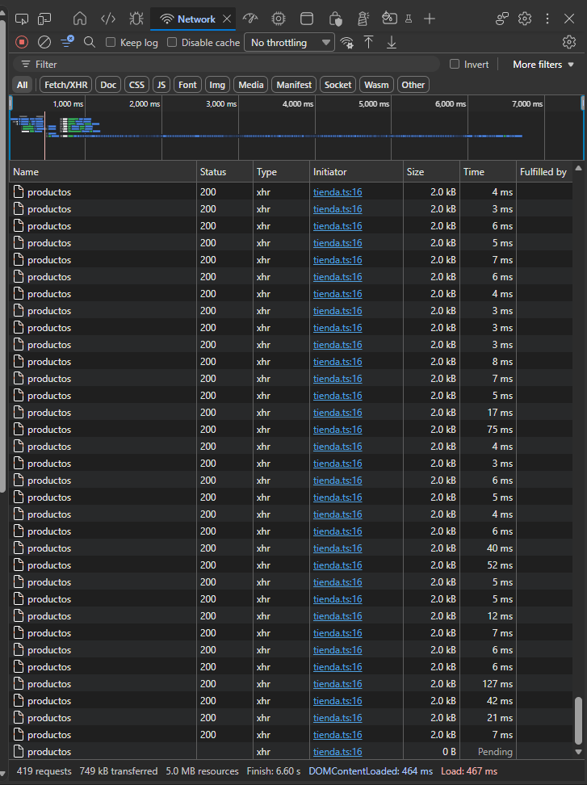

# Frontend-Web-Practicas

## PRACTICA 14 - La Tienda

1. ¿por qué en la pestaña Red salen dos peticiones al cargar?
Porque React usa un "Modo Estricto" mientras estás programando para ayudarte a detectar errores. Esto hace que el código se ejecute dos veces a propósito, pero cuando el proyecto esté terminado solo pasará una vez.
2. ¿qué pasa si quitas el arreglo de dependencias del efecto? Muéstralo en la pestaña Red
Se crea un bucle infinito. La aplicación pedirá los datos, actualizará la pantalla, y eso provocará que los vuelva a pedir sin parar hasta trabar tu navegador.

3. ¿qué hace e.preventDefault() y qué pasa si lo quitas?
Evita que la página web se recargue automáticamente al enviar el formulario. Si lo quitas, la página se va a refrescar al darle a pagar, borrando los datos de tu carrito y evitando que la compra se procese.